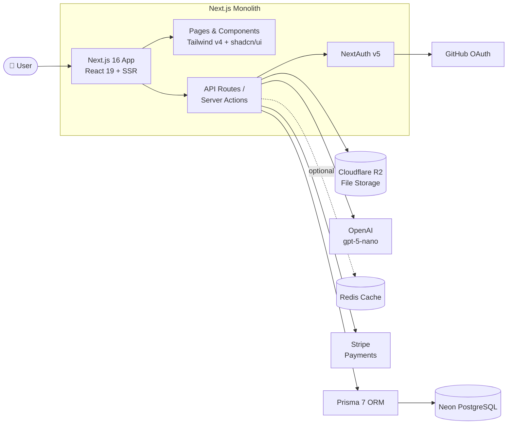
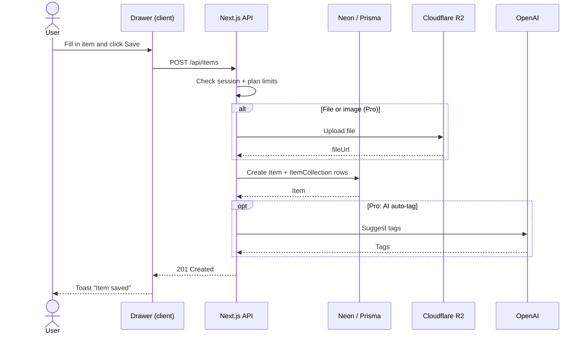
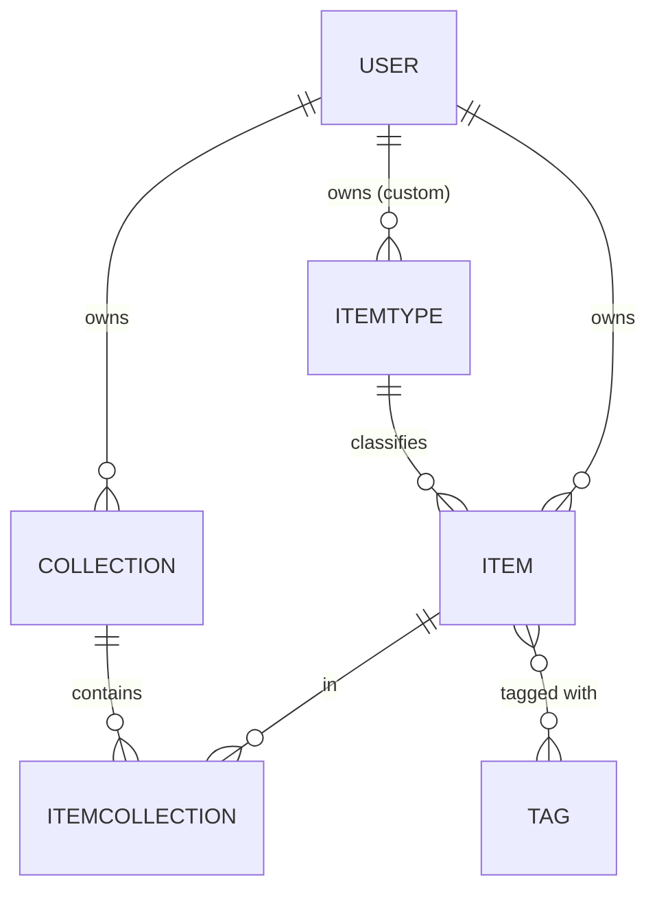

# 🗃️ DevStash — Project Overview

> **One fast, searchable, AI-enhanced hub for all your dev knowledge & resources.**

| | |
|---|---|
| **Type** | Freemium SaaS |
| **Status** | 📝 Planning |
| **Platform** | Web (desktop-first, mobile usable) |

---

## 📑 Table of Contents

1. [Problem](#-problem)
2. [Target Users](#-target-users)
3. [Features](#-features)
4. [Architecture](#-architecture)
5. [Data Model](#-data-model-rough-draft)
6. [Tech Stack](#-tech-stack)
7. [Monetization](#-monetization)
8. [UI / UX](#-ui--ux)
9. [Open Questions](#-open-questions)
10. [Suggested Roadmap](#-suggested-roadmap)

---

## 🔥 Problem

Developers keep their essentials scattered everywhere:

| What | Where it ends up |
|---|---|
| 💻 Code snippets | VS Code, Notion |
| ✨ AI prompts | Buried in chat histories |
| 📄 Context files | Deep inside project folders |
| 🔗 Useful links | Browser bookmarks |
| 📚 Docs | Random folders |
| ⌨️ Commands | `.txt` files, bash history |
| 🧱 Project templates | GitHub Gists |

The result is **context switching, lost knowledge, and inconsistent workflows**. DevStash gives developers a single place for all of it.

---

## 👥 Target Users

| Persona | Needs |
|---|---|
| 🧑‍💻 **Everyday Developer** | A fast way to grab snippets, prompts, commands and links |
| 🤖 **AI-first Developer** | Save prompts, contexts, workflows and system messages |
| 🎓 **Content Creator / Educator** | Store code blocks, explanations and course notes |
| 🛠️ **Full-stack Builder** | Collect patterns, boilerplates and API examples |

---

## ✨ Features

### A. Items & Item Types

Every piece of content is an **Item** with a **Type**. Users will eventually create custom types (Pro, later). The MVP ships with these **system types**, which cannot be modified:

| Icon | Type | Content kind | Tier |
|---|---|---|---|
| 💻 | `snippet` | text | Free |
| ✨ | `prompt` | text | Free |
| 📝 | `note` | text | Free |
| ⌨️ | `command` | text | Free |
| 🔗 | `link` | url | Free |
| 📎 | `file` | file | **Pro** |
| 🖼️ | `image` | file | **Pro** |

- Each type has a **content kind**: `text` (snippet, prompt, note, command), `url` (link) or `file` (file, image).
- Routes are type-based, e.g. `/items/snippets`, `/items/prompts`.
- Items must be **quick to open and create**, using a slide-over **drawer**.

### B. Collections

Collections group items of **any type**. An item can belong to **multiple collections** (e.g. a React snippet in both *React Patterns* and *Interview Prep*).

Examples:

- 📁 React Patterns — snippets, notes
- 📁 Context Files — files
- 📁 Python Snippets — snippets

### C. Search 🔍

Search across **content**, **tags**, **titles** and **types**.

### D. Authentication 🔐

- Email + password
- GitHub OAuth

### E. Other Features

- ⭐ Favorite items and collections
- 📌 Pin items to the top
- 🕘 Recently used
- 📥 Import code from a file
- 🧾 Markdown editor for text types
- 📤 File upload for file/image types
- 💾 Export data (JSON/ZIP)
- 🌙 Dark mode by default (light optional)
- ➕ Add/remove items to/from multiple collections
- 👀 See which collections an item belongs to

### F. AI Features (Pro only) 🤖

- 🏷️ Auto-tag suggestions
- 🧠 Summaries
- 💡 "Explain this code"
- 🪄 Prompt optimizer

---

## 🏗️ Architecture



### Typical request flow: saving an item



---

## 🗄️ Data Model (Rough Draft)

> ⚠️ **This is a rough draft, not a final schema.** Field names, types, indexes and cascade rules are all subject to change. Verify the generator/datasource syntax against the latest Prisma 7 docs before implementing.



```prisma
// prisma/schema.prisma — ROUGH DRAFT

generator client {
  provider = "prisma-client-js" // check Prisma 7 docs for current generator
}

datasource db {
  provider = "postgresql"
}

// ───────────── Auth (NextAuth v5 / Auth.js adapter models) ─────────────

model User {
  id            String    @id @default(cuid())
  name          String?
  email         String?   @unique
  emailVerified DateTime?
  image         String?
  password      String?   // hashed; null for OAuth-only users

  // Billing
  isPro                  Boolean @default(false)
  stripeCustomerId       String? @unique
  stripeSubscriptionId   String? @unique

  accounts    Account[]
  sessions    Session[]
  items       Item[]
  collections Collection[]
  itemTypes   ItemType[]

  createdAt DateTime @default(now())
  updatedAt DateTime @updatedAt
}

model Account {
  id                String  @id @default(cuid())
  userId            String
  type              String
  provider          String
  providerAccountId String
  refresh_token     String? @db.Text
  access_token      String? @db.Text
  expires_at        Int?
  token_type        String?
  scope             String?
  id_token          String? @db.Text
  session_state     String?

  user User @relation(fields: [userId], references: [id], onDelete: Cascade)

  @@unique([provider, providerAccountId])
}

model Session {
  id           String   @id @default(cuid())
  sessionToken String   @unique
  userId       String
  expires      DateTime
  user         User     @relation(fields: [userId], references: [id], onDelete: Cascade)
}

model VerificationToken {
  identifier String
  token      String   @unique
  expires    DateTime

  @@unique([identifier, token])
}

// ───────────── Core domain ─────────────

enum ContentType {
  TEXT
  FILE
}

model Item {
  id          String      @id @default(cuid())
  title       String
  contentType ContentType
  content     String?     @db.Text // text content; null if file
  fileUrl     String?              // R2 URL; null if text
  fileName    String?              // original filename
  fileSize    Int?                 // bytes
  url         String?              // for link types
  description String?
  language    String?              // optional, for code
  isFavorite  Boolean     @default(false)
  isPinned    Boolean     @default(false)
  lastUsedAt  DateTime?            // supports "recently used"

  userId     String
  itemTypeId String
  user       User       @relation(fields: [userId], references: [id], onDelete: Cascade)
  itemType   ItemType   @relation(fields: [itemTypeId], references: [id])
  tags       Tag[]
  collections ItemCollection[]

  createdAt DateTime @default(now())
  updatedAt DateTime @updatedAt

  @@index([userId, itemTypeId])
  @@index([userId, isPinned])
}

model ItemType {
  id       String  @id @default(cuid())
  name     String  // snippet, prompt, note, command, file, image, link
  icon     String  // Lucide icon name
  color    String  // hex
  isSystem Boolean @default(false)

  userId String? // null for system types
  user   User?   @relation(fields: [userId], references: [id], onDelete: Cascade)
  items  Item[]

  @@unique([userId, name])
}

model Collection {
  id            String  @id @default(cuid())
  name          String
  description   String?
  isFavorite    Boolean @default(false)
  defaultTypeId String? // type to suggest for new, empty collections

  userId String
  user   User   @relation(fields: [userId], references: [id], onDelete: Cascade)
  items  ItemCollection[]

  createdAt DateTime @default(now())
  updatedAt DateTime @updatedAt
}

// Join table: an item can live in many collections
model ItemCollection {
  itemId       String
  collectionId String
  addedAt      DateTime @default(now())

  item       Item       @relation(fields: [itemId], references: [id], onDelete: Cascade)
  collection Collection @relation(fields: [collectionId], references: [id], onDelete: Cascade)

  @@id([itemId, collectionId])
}

model Tag {
  id    String @id @default(cuid())
  name  String @unique
  items Item[]
}
```

**Notes on the draft**

- `Tag` is global here for simplicity. Per-user tags (`userId` + `@@unique([userId, name])`) would prevent cross-user leakage and are probably the better choice.
- `lastUsedAt` is an addition to support the "Recently used" feature.
- System `ItemType` rows are seeded, with `userId = null`.
- Full-text search on `title`/`content` will likely need a Postgres `tsvector` or `pg_trgm` index (see [Open Questions](#-open-questions)).

> 🚨 **Migrations only.** **Never** use `prisma db push` or edit the DB structure directly. Create migrations (`prisma migrate dev`), run them in dev, then apply them in prod (`prisma migrate deploy`).

---

## 🧰 Tech Stack

| Layer | Choice | Notes |
|---|---|---|
| Framework | [Next.js 16](https://nextjs.org/docs) / [React 19](https://react.dev) | SSR pages with dynamic components; API routes for items, uploads, AI calls |
| Language | [TypeScript](https://www.typescriptlang.org/docs/) | Type safety; single repo/codebase for less overhead |
| Database | [Neon](https://neon.tech/docs) (PostgreSQL) | Serverless cloud Postgres |
| ORM | [Prisma 7](https://www.prisma.io/docs) | Check latest docs before implementing |
| Cache | [Redis](https://redis.io/docs/) | *Maybe*, only if needed |
| File storage | [Cloudflare R2](https://developers.cloudflare.com/r2/) | File/image uploads |
| Auth | [NextAuth v5 (Auth.js)](https://authjs.dev) | Email/password + [GitHub OAuth](https://docs.github.com/en/apps/oauth-apps) |
| AI | [OpenAI](https://platform.openai.com/docs) `gpt-5-nano` | Tagging, summaries, explain, prompt optimizer |
| Payments | [Stripe](https://docs.stripe.com) | Subscriptions (implied by the `stripe*` fields) |
| Styling | [Tailwind CSS v4](https://tailwindcss.com/docs) + [shadcn/ui](https://ui.shadcn.com) | |
| Icons | [Lucide](https://lucide.dev/icons/) | Used for item types |

---

## 💰 Monetization

Freemium model.

| | 🆓 Free | ⭐ Pro — **$8/mo** or **$72/yr** |
|---|:---:|:---:|
| Items | 50 total | Unlimited |
| Collections | 3 | Unlimited |
| System types | All except file/image | All |
| Search | Basic | Basic |
| File & image uploads | ❌ | ✅ |
| AI features (tags, explain, optimizer) | ❌ | ✅ |
| Export (JSON/ZIP) | ❌ | ✅ |
| Custom types | ❌ | ✅ *(later)* |
| Priority support | ❌ | ✅ |

> 💡 The yearly plan works out to **$6/mo**, a 25% saving over monthly.

> 🛠️ **Development note:** Build the Pro foundation now (`isPro` flag, limit checks, feature gates), but **during development all users get full access**. A feature flag or env var is enough to switch enforcement on later.

---

## 🎨 UI / UX

### General

- Modern, minimal, developer-focused
- Dark mode by default, light mode optional
- Clean typography, generous whitespace, subtle borders and shadows
- Syntax highlighting for code blocks
- References: **Notion**, **Linear**, **Raycast**

### Layout

```
┌──────────────┬──────────────────────────────────────────┐
│ ☰ DevStash   │  🔍 Search…                    [+ New]   │
├──────────────┼──────────────────────────────────────────┤
│ TYPES        │  COLLECTIONS                             │
│  💻 Snippets │  ┌────────┐ ┌────────┐ ┌────────┐        │
│  ✨ Prompts  │  │ React  │ │ Prompts│ │ Context│        │
│  ⌨️ Commands │  │Patterns│ │  Pack  │ │ Files  │        │
│  📝 Notes    │  └────────┘ └────────┘ └────────┘        │
│  📎 Files    │                                          │
│  🖼️ Images   │  ITEMS                                   │
│  🔗 Links    │  ┌──────────────┐ ┌──────────────┐       │
│              │  │ ▌useDebounce │ │ ▌git rebase  │       │
│ COLLECTIONS  │  └──────────────┘ └──────────────┘       │
│  📁 Latest…  │                        ┌───────────────┐ │
│              │                        │ Item drawer → │ │
└──────────────┴────────────────────────┴───────────────┴─┘
```

- **Sidebar** (collapsible): item types linking to their item lists, plus latest collections.
- **Main**: grid of collection cards. Card **background colour** reflects the item type the collection holds the most of. Items display in cards with a **border colour** matching their type.
- **Drawer**: individual items open in a quick-access drawer.
- **Mobile**: the sidebar becomes a drawer.

### Type Colours & Icons

| Type | Colour | Hex | Lucide icon |
|---|---|---|---|
| Snippet | 🔵 Blue | `#3b82f6` | [`Code`](https://lucide.dev/icons/code) |
| Prompt | 🟣 Purple | `#8b5cf6` | [`Sparkles`](https://lucide.dev/icons/sparkles) |
| Command | 🟠 Orange | `#f97316` | [`Terminal`](https://lucide.dev/icons/terminal) |
| Note | 🟡 Yellow | `#fde047` | [`StickyNote`](https://lucide.dev/icons/sticky-note) |
| File | ⚪ Gray | `#6b7280` | [`File`](https://lucide.dev/icons/file) |
| Image | 🩷 Pink | `#ec4899` | [`Image`](https://lucide.dev/icons/image) |
| Link | 🟢 Emerald | `#10b981` | [`Link`](https://lucide.dev/icons/link) |

### Responsive

- Desktop-first, mobile usable
- Sidebar collapses into a drawer on mobile

### Micro-interactions

- Smooth transitions
- Hover states on cards
- Toast notifications for actions
- Loading skeletons

---

## ❓ Open Questions

- **Search implementation**: Postgres full-text search (`tsvector`) / `pg_trgm`, or an external engine later?
- **Tags**: global or per-user? (Per-user suggested.)
- **Free-limit enforcement**: "50 items total": does that include file items for downgraded Pro users?
- **Downgrade behaviour**: what happens to files and extra collections when a Pro user cancels?
- **Export**: JSON for text items; ZIP bundling R2 files. Is export Pro-only, or a basic free export too?
- **Email/password**: need verification emails and password reset (which email provider?).
- **AI cost control**: rate limits and usage caps per Pro user on `gpt-5-nano` calls.
- **Redis**: only introduce if a measured need appears (e.g. rate limiting, caching).
- **Collection card colour**: tie-break when two types have equal counts.

---

## 🗺️ Suggested Roadmap

```mermaid
gantt
    title DevStash — Suggested Phases
    dateFormat  X
    axisFormat  Phase %s
    section Foundation
    Project setup, Prisma + Neon, migrations   :0, 1
    Auth (email + GitHub)                      :1, 2
    section Core
    Items, types, drawer                       :2, 3
    Collections + join table                   :3, 4
    Search, favorites, pins, recents           :4, 5
    section Pro
    File/image uploads (R2)                    :5, 6
    Stripe + plan limits                       :6, 7
    AI features                                :7, 8
    section Polish
    Export, import, markdown editor, UX polish :8, 9
```



1. **Foundation**: Next.js app, Neon, Prisma migrations, seed system types
2. **Auth**: NextAuth v5 with credentials + GitHub
3. **Core**: items, drawer, collections, tags
4. **Discovery**: search, favorites, pins, recently used
5. **Pro**: R2 uploads, Stripe, limit enforcement
6. **AI**: auto-tag, summaries, explain, prompt optimizer
7. **Polish**: export/import, markdown editor, responsive and micro-interactions
